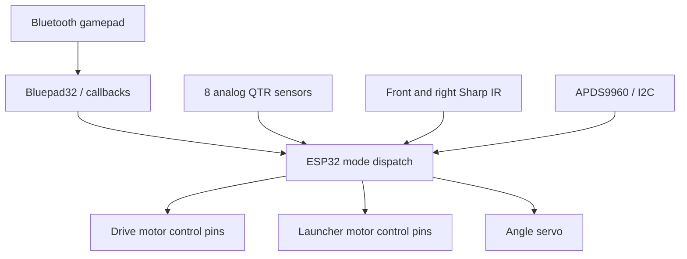

# IEEE RAS Robotathon 2025

ESP32 competition robot firmware combining Bluetooth control, line following, color detection, and infrared wall navigation, with KiCad design files.

Moneer Hijaz served as **Lead Programmer** for the team entry, which placed **first** and received **Most Creative Code**. Role and outcome are recorded in the owner's approved portfolio questionnaire and [competition write-up](https://hijaz.dev/experience/robotathon-2025/); this checkout does not contain an independent competition results sheet. Mechanical and electrical work were team contributions.

## What is implemented

- Bluetooth gamepad mode selection through Bluepad32.
- Manual differential drive, launcher ramping, and an angle servo.
- Eight-element QTR line sensing with calibration and an active bang-bang follower.
- APDS9960 color sampling and front/right Sharp IR wall-navigation routines.
- Alternative PID and wall-correction experiments retained in source.

**Safety and validation:** hardware was not available for this review. The disconnect callback clears the controller pointer but does not stop motors; blocking calibration/turn/launcher routines can delay input handling. A mode button is not an emergency stop. Keep drive wheels raised and launcher power disconnected during initial testing, with an independent power cutoff available.

## Architecture

The firmware defines drive pins 19/18 and 17/16, launcher pins 4/5, servo pin 23, color I2C pins 21/22, front/right IR pins 25/26, and line pins 36/35/34/14/13/39/33/32. Left/right labels in source comments conflict; confirm actual wiring with motor power disabled. `Spy/` contains the KiCad schematic/board and fabrication exports; their presence is not evidence of manufacture.

## Build and controls

Use ESP-IDF **4.4.8** as the reproduction candidate; vendored Arduino explicitly requires IDF 4.4.x. See [build and flash](docs/build-and-flash.md) for commands, limitations, and the hardware checklist.

| Input | Active behavior |
| --- | --- |
| B | Manual mode: left stick drives, right stick steers; bumpers rotate at neutral |
| A | Color automation |
| X | Front/right wall automation |
| Y | Line automation; first entry starts moving calibration and returns to manual |
| R2 in manual | Launcher ramp control |
| D-pad up/down in manual | Servo open/closed (60/0 degrees) |

## Source map and design notes

- `main/arduino_main.cpp`: sensors, motor outputs, modes, experimental alternatives.
- `components/callbacks/`: controller lifecycle; other components are vendored dependencies.
- `Spy/`, `Robotathon_kicad/`: board/schematic and component assets.
- `docs/engineering-notes.md`: preserved calibration, equations, settings, and alternative algorithms.
- `notes.pdf`: original project document, retained in place.
- `RobotathonESP32`: historical gitlink without a `.gitmodules` mapping; the root project is the documented build entry point.

The active bang-bang follower makes discrete corrections; the retained PID implementation shows the alternative tradeoff. Timed wall turns depend on battery, traction, and geometry rather than measured heading.

## Credits and licensing

Preserve the template's Ricardo Quesada attribution, vendored library notices, and [component licensing](LICENSE). The source credits Fabian's alternative line algorithm. Confirm the complete teammate roster and ownership of board/library assets before redistributing them separately. No new blanket license is assigned.
